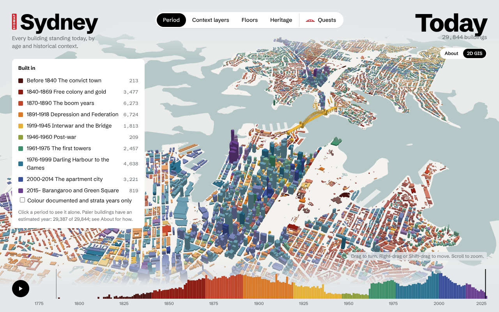
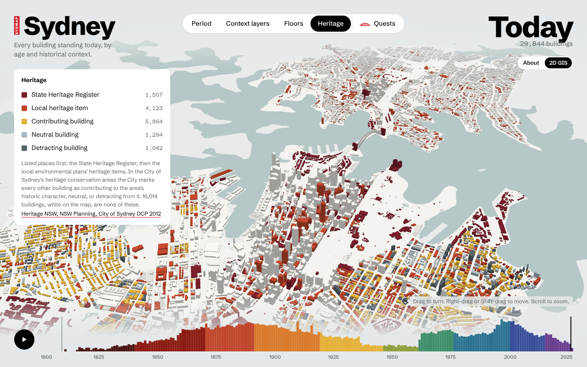
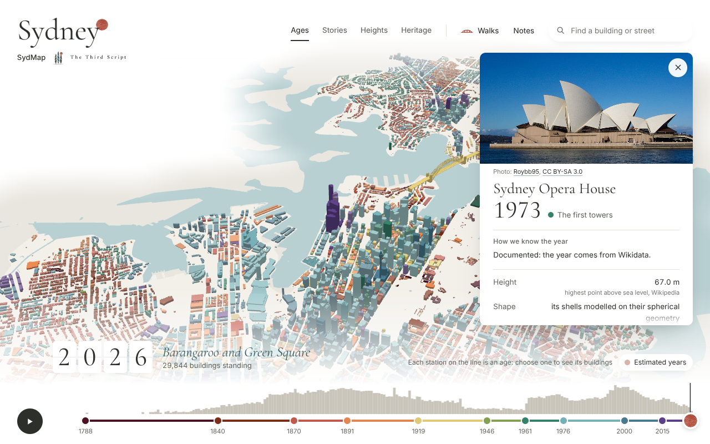
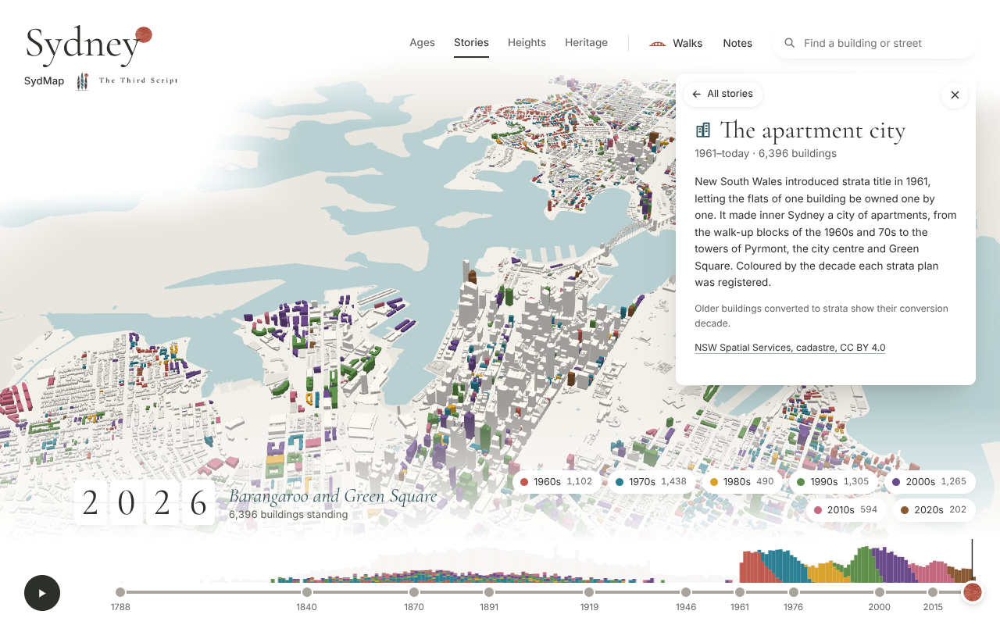
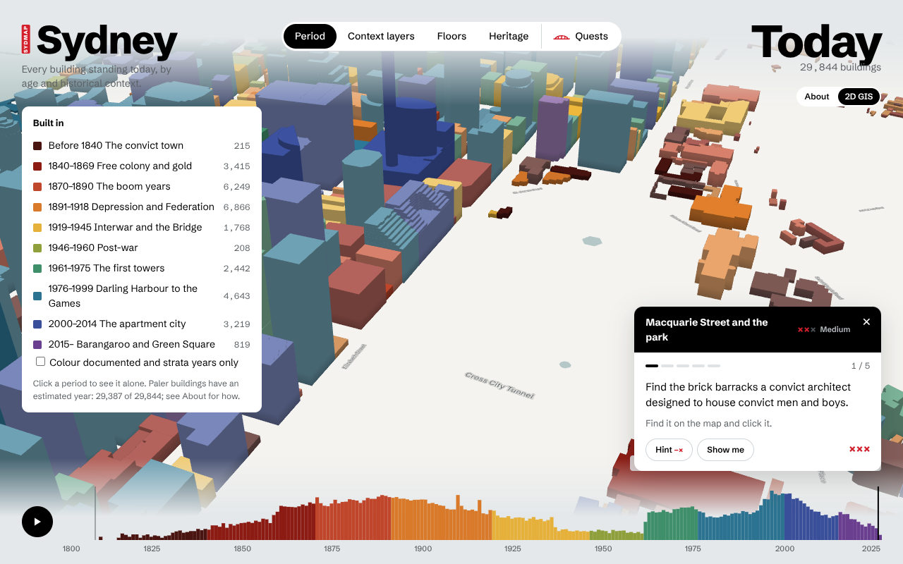
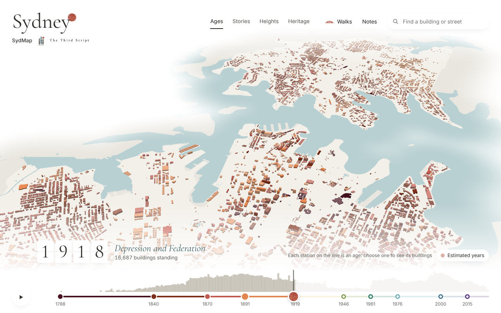
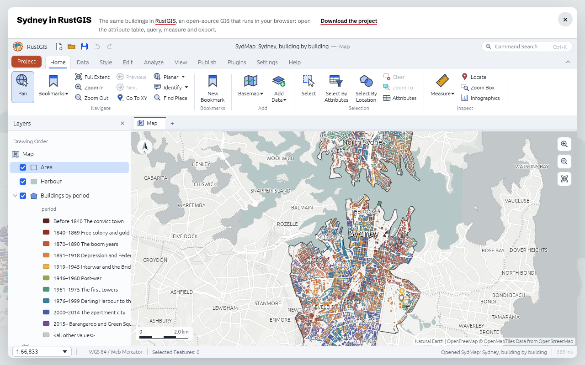
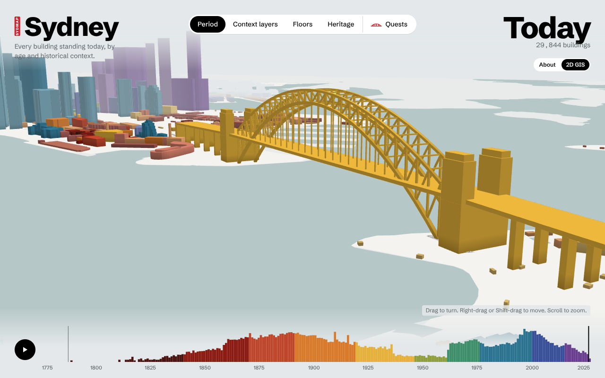
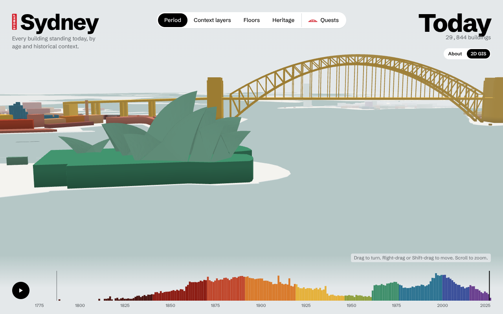

# SydMap: Sydney, building by building

Every building in the City of Sydney and North Sydney, either side of the Harbour Bridge, in 3D: 29,844 of them,
coloured by the year they were built and set in the history that shaped them. Drag the timeline to watch the city
grow from the convict town, switch to context layers, storeys or heritage status, open any building's card, play the
quests, or open the same buildings in a full GIS.



SydMap rebuilds [LAYRS: Amsterdam](https://stop-token.com/lab/amsterdam/) by Alex Barakov
([source](https://github.com/alexbarakov/amsterdam-by-building), MIT) for Sydney. Its look was read off the
Amsterdam page with [designlang](https://github.com/Manavarya09/design-extract), and its 2D view runs
[RustGIS](https://github.com/opengeos/RustGIS). A non-commercial project, made out of curiosity and for education.

**Run it locally:** `python3 scripts/serve.py` and open <http://localhost:8642>. The built data is in the
repository, so nothing else is needed. **Publish it:** see [GitHub Pages](#publishing-on-github-pages).

SydMap acknowledges the Gadigal people of the Eora Nation, the Traditional Custodians of the land the City of Sydney
stands on, and the Cammeraygal people, the Traditional Custodians of the land of North Sydney.

| | |
|---|---|
|  |  |
| **Heritage**: State Heritage Register, local items, and the City's contributing, neutral and detracting buildings | **Cards**: photo, Wikipedia, layers, heights, heritage listing, and the evidence behind the year |
|  |  |
| **Context layers**: Aboriginal Sydney, architects, styles, worship, pubs, Developing Sydney 1900–1920, strata, the skyline | **Quests**: 25 riddles in five walks, every claim checked against Wikipedia |
|  |  |
| **The film**: the city as it stands, building up year by year | **2D GIS**: the same buildings in the RustGIS web app, styled by period |

## How it was made

1. **Design, extracted.** `scripts/extract-design.sh` runs designlang against the Amsterdam page; its output is in
   [`design/amsterdam-extract/`](design/amsterdam-extract) (DTCG tokens, `DESIGN.md`, CSS variables, a brand book,
   screenshots). SydMap keeps the extracted system (sky `#e4e8ea`, paper, ink, Schibsted Grotesk, pills, 10 px cards,
   the period ramp) and changes only the accent, to waratah red, and the wordmark. See [`design/README.md`](design/README.md).
2. **Viewer.** [`web/`](web) is the LAYRS three.js viewer (no build step), adapted: Sydney's periods and texts, a
   Heritage mode in place of Amsterdam's energy labels, cards that show the evidence for every year, part bases in
   the tile format (so floating parts can be drawn), meshes for shapes extrusion cannot draw (the Opera House's
   shells, the Harbour Bridge), and a 2D GIS dialog.
3. **Data.** [`pipeline/`](pipeline) (Python, `uv`) turns open data into the binary tiles and JSON the viewer reads.
4. **RustGIS.** RustGIS is a full GIS (ribbon, attribute table, analysis), not a library for a bespoke 3D city, so
   three.js keeps the 3D map and RustGIS does what it is good at: `pipeline/s09_rustgis.py` uses its Python engine
   (`pip install rustgis`) to build a styled project of every building and render a static map
   ([`docs/rustgis-period-map.png`](docs/rustgis-period-map.png)); the page embeds the RustGIS web app
   (`web.rustgis.app/?embed`) and sends it that project, so readers can open the attribute table, query, measure and
   export. The project also downloads as a `.rgis` file for the RustGIS desktop app.

## How old is each building?

Amsterdam has BAG, a national register with a construction year for every building. Sydney has nothing like it, so
each building takes the best evidence there is, and its card says which:

| Evidence | Buildings | How |
|---|---:|---|
| Documented | 457 | a year from the lead of the building's Wikipedia article (327; for heritage-listed places these are written from the NSW State Heritage Inventory: "built from 1898 to 1900"), Wikidata (76) or OpenStreetMap `start_date` (54) |
| Strata plan | 5,548 | apartment buildings are strata-titled on completion. The NSW cadastre gives every plan registered since 1994 its date; a monotone fit of plan number against date places the older plans between SP1 (1961, when strata title began) and SP44479 (1994) |
| Heritage listing | 147 | the other buildings of a State Heritage Register listing (Luna Park's pavilions, the Mint's outbuildings, the Harbour Bridge's approaches) take the years the listing's Wikipedia article gives; precincts, parks, tunnels and railway stations (dated by their opening) do not pass their years on |
| Heritage area | 14,290 | buildings the City of Sydney's DCP 2012 marks as contributing to a heritage conservation area (and low-rise buildings in North Sydney's conservation areas) are dated from the documented heritage buildings around them |
| Neighbours | 9,402 | the rest take the weighted quartiles of the dated buildings around them of similar height; towers over 46 m (Sydney's height limit until 1957) only take years after 1957, detracting buildings only years after 1945 |

Estimated years (everything but the first row) are spread within their range so the film does not drop a suburb in a
single year; they are paler on the map, marked "c." on the cards with the range, and the Period legend can switch them
off ("Colour documented and strata years only"). Treat them as an educated guess about the period, not as a date.

Heights come from OpenStreetMap where it has them (12,273, measured or from storeys), from GlobalBuildingAtlas
(14,180, modelled from satellite imagery) and are otherwise assumed to be two storeys (3,389).

Two landmarks are modelled as meshes, see [`pipeline/landmarks.py`](pipeline/landmarks.py). The Harbour Bridge is
built from its Wikipedia figures: two 28-panel arch trusses, 18 m deep at the summit and 57 m at the ends, spanning
504 m and rising to 134 m, under a deck 48.8 m wide. It stands on the line between OpenStreetMap's two pairs of 89 m
pylons, which are split either side of the roadway, and runs the length of OpenStreetMap's way for its deck. The
article does not give the deck's height or the approaches, so the deck is 49 m above the water between the pylons and
falls gently along five approach spans each side.



The Opera House's shells, which OpenStreetMap maps only as flat roof pieces, are a mesh built on the geometry they were
built to, as Ove Arup & Partners' Michael Lewis described it in
[*Roof cladding of the Sydney Opera House*](https://www.royalsoc.org.au/wp-content/uploads/2024/09/106_12_lewis.pdf)
(Journal and Proceedings of the Royal Society of NSW, 1973): every half-shell is a spherical triangle "standing on a
vertex", cut from a sphere of 75.2 m, its ribs great circles fanning out from the pedestal. The Concert Hall's shells
are measured off the paper's western elevation, scaled to the 67 m highest point, and placed on OpenStreetMap's plan
of the roof, which they match to within about 2 m; the Joan Sutherland Theatre's roof is the same layout at 0.79 of
the size, as the plan shows, and the restaurant's two shells are placed from the plan with heights estimated from
photographs. Side shells are plain triangles, and the glass walls are left out.



## Data and licences

| Data | Source | Licence |
|---|---|---|
| Footprints and building parts | [Overture Maps](https://overturemaps.org) 2026-09-23 (OpenStreetMap, Microsoft ML footprints) | ODbL |
| Building tags, streets, water names, worship, pubs | [OpenStreetMap](https://www.openstreetmap.org) via Overpass | ODbL |
| Modelled heights | [GlobalBuildingAtlas](https://github.com/zhu-xlab/GlobalBuildingAtlas) (Zhu et al., TUM, 2025) via Source Cooperative | CC BY-NC 4.0 |
| Boundaries, strata plans | NSW Spatial Services | CC BY 4.0 |
| State Heritage Register; LEP heritage items and conservation areas | Heritage NSW; NSW Department of Planning | CC BY 4.0 |
| Heritage contributions, Aboriginal history places, Developing Sydney 1900–1920 | [City of Sydney open data](https://data.cityofsydney.nsw.gov.au) | CC BY 4.0 |
| Names, dates, architects, styles | Wikidata | CC0 |
| Article extracts, built years, quest facts | English Wikipedia | CC BY-SA 4.0 |
| The Opera House's shell geometry (measurements, not copied) | M. Lewis, *Roof cladding of the Sydney Opera House*, J. Proc. Roy. Soc. NSW 106 (1973) | facts |
| Photos | Wikimedia Commons, each credited on its card | per file |
| Land and water | Overture Maps base theme (OpenStreetMap) | ODbL |
| 2D basemap | [OpenFreeMap](https://openfreemap.org) | OpenMapTiles, ODbL |

The GlobalBuildingAtlas heights are non-commercial, one more reason SydMap is a non-commercial project. The GIS
export (`web/data/gis/`) leaves them out, and `SYDMAP_NO_GBA=1` builds the whole map without them.

Code: MIT, keeping the original LAYRS copyright (see [`LICENSE`](LICENSE)). three.js (MIT) is vendored in `web/vendor/`.

## Run the pipeline

```bash
uv sync
uv run python -m pipeline.run            # all steps; raw downloads are cached in data/raw/
uv run python -m pipeline.run s05 s03    # some steps, by prefix
uv run python -m pipeline.checks         # check every quest and landmark claim against Wikipedia
uv run pytest                            # offline tests
python3 scripts/serve.py                 # http://localhost:8642, with byte ranges like GitHub Pages
```

| Step | What it does |
|---|---|
| `s00_fetch` | Downloads every source into `data/raw/` (Overture and GlobalBuildingAtlas through DuckDB on S3, Overpass, Wikidata, Wikipedia, ArcGIS services) |
| `s01_load` | Footprints in the two LGAs, OSM tags, 3D parts, heights and storeys; the Harbour Bridge and Opera House models |
| `s02_years` | Wikidata links, documented years, heritage status, strata calibration, estimates |
| `s04_water` | Land, water and the other shores |
| `s05_layers` | Context layers, one bit per group per building |
| `s06_wiki` | Card data: Wikipedia leads, Commons photos and credits, names, heritage listings |
| `s03_tiles` | 600 m binary tiles in six packs, `attrs.bin`, `sydney.json` |
| `s07_labels` | Street and harbour names laid along their lines |
| `s08_quests` | Quests resolved to buildings, every claim checked (`checks.py`) |
| `s09_rustgis` | GeoParquet export, the RustGIS project and its rendered map |

The area is set in [`pipeline/config.py`](pipeline/config.py) (`LGAS`, `BBOX`): add an LGA and its box to grow the map.

## Publishing on GitHub Pages

`.github/workflows/pages.yml` publishes `web/`. Switch Pages on once (Settings › Pages › Source: **GitHub Actions**),
then run *Deploy to GitHub Pages* from the Actions tab, or set the repository variable `DEPLOY_PAGES` to `true` to
deploy on every push. The site will be at `https://amarashi.github.io/SydMap/`.

## Limitations

- Most years are estimates (see above); the documented ones cluster in the city centre and The Rocks.
- OpenStreetMap often maps a terrace row as one building, so "buildings" here are mapped structures, not addresses.
- About half the heights are modelled from satellite imagery and can be several metres off.
- The ground is flat: Sydney's ridges and gullies are not modelled.

## Contributing

Know a piece of Sydney's history that lives in its buildings? See [CONTRIBUTING.md](CONTRIBUTING.md) to add a layer or
a quest.
