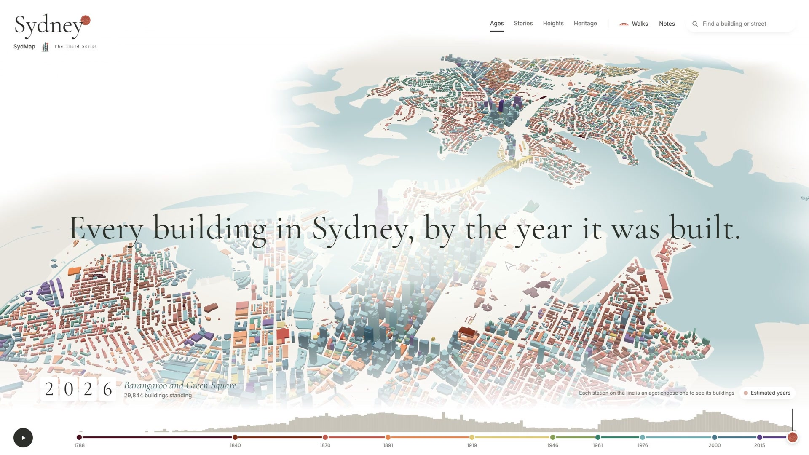
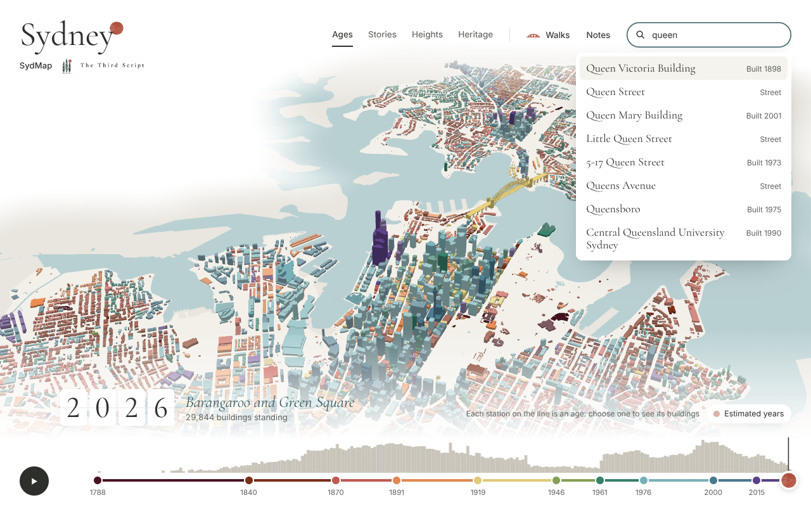

# SydMap: Sydney, year by year

Every building around Sydney Harbour in 3D, 125,684 buildings in all, coloured by the age of the city they belong
to. Move along the line at the bottom, or press play, to watch Sydney grow from the convict town; look at it by its
stories, heights or heritage; open any building to read how its year is known; follow a walk through the streets; or
take every building's data with you.

**The area:** both shores of Sydney Harbour and the Parramatta River, from Putney and Concord in the west to Manly
in the north-east, and the ocean coast from Bondi to Coogee. It covers thirteen councils, some whole and some only in
part. They are listed further down with their Traditional Custodians, and for each council taken in part the list
names the suburbs on the map.

[](brag-output/brag.mp4)

**The film:** [brag-output/brag.mp4](brag-output/brag.mp4), 25 seconds, recorded from the site; the score was generated
locally for it. How it was made is in [`brag-output/brag-plan.md`](brag-output/brag-plan.md).

SydMap rebuilds [LAYRS: Amsterdam](https://stop-token.com/lab/amsterdam/) by Alex Barakov
([source](https://github.com/alexbarakov/amsterdam-by-building), MIT) for Sydney, itself inspired by Alexander Bogachev's
[Paris, building by building](https://paris.bogachev.fr). It is made by Amir Marashi at
[The Third Script](https://thethirdscript.com) and wears the studio's colours (see [`DESIGN.md`](DESIGN.md)). A
non-commercial project, made out of curiosity and for education.

**Run it locally:** `python3 scripts/serve.py` and open <http://localhost:8642>. The built data is in the
repository, so nothing else is needed. **Publish it:** see [Cloudflare](#publishing-on-cloudflare).

SydMap acknowledges the Traditional Custodians of the land it maps. Each council below is followed by the
peoples it names as custodians:

- the City of Sydney: the Gadigal people of the Eora Nation
- North Sydney: the Cammeraygal people
- Lane Cove: the Cammeraygal people
- Mosman: the Borogegal people
- Woollahra: the Gadigal and Birrabirragal peoples
- Hunters Hill: the Wallumedegal people
- Waverley, from Bondi Junction to Bondi Beach: the Bidjigal, Birrabirragal and Gadigal peoples
- the Inner West, in part (Balmain, Balmain East, Birchgrove, Rozelle, Lilyfield, Annandale, Leichhardt, Stanmore,
  Enmore, Petersham, Lewisham, Marrickville, Dulwich Hill, Sydenham, Tempe, and the council's side of Camperdown,
  Newtown and St Peters): the Gadigal and Wangal peoples
- Canada Bay, in part (Drummoyne, Russell Lea, Rodd Point, Five Dock, Abbotsford, Chiswick, Wareemba, Concord,
  Cabarita, Mortlake, Breakfast Point and Canada Bay): the Wangal people
- Willoughby, in part (Northbridge, Castlecrag, Middle Cove, Castle Cove and Naremburn): the Gamaragal people
- the Northern Beaches, in part (Manly, Fairlight, Balgowlah, Balgowlah Heights, Clontarf and Seaforth): the
  Gayamaygal and Garigal peoples, named on the council's own signs
- Ryde, in part (Gladesville, Putney and Tennyson Point): the Wallumedegal people
- Randwick, in part (Clovelly, Coogee, South Coogee and Randwick): the Bidjigal and Gadigal peoples

| | |
|---|---|
|  |  |
| **Heritage**: State Heritage Register, local items, and the City's contributing, neutral and detracting buildings | **A building**: photo, Wikipedia, its stories, heights, heritage listing, and how its year is known |
|  |  |
| **Stories**: Aboriginal Sydney, architects, styles, worship, pubs, Developing Sydney 1900–1920, strata, the skyline | **Walks**: 25 riddles on five routes, every claim checked against Wikipedia |
|  |  |
| **The line through time**: the city in any year, its ten ages as stations along the line | **Find**: any named building, street or stretch of water, and the map flies there |

## How it was made

1. **Design.** The first version kept the Amsterdam page's design system and layout, read off it with
   [designlang](https://github.com/Manavarya09/design-extract) (`scripts/extract-design.sh`; the output is in
   [`design/amsterdam-extract/`](design/amsterdam-extract)). SydMap now has its own: The Third Script's colours and type
   (a white wall, the logo's cypress teal for the harbour, its terracotta sun, Cormorant Garamond and Inter), and its
   own layout and words. Time runs along the bottom as one line of ten ages, with the sun as the year and the year on
   paper flaps; the lenses (Ages, Stories, Heights, Heritage), Walks, Notes and a search sit across the top; anything
   to read opens in one dock on the right; and the ground fades into the white beyond the buildings. See
   [`DESIGN.md`](DESIGN.md) and [`design/README.md`](design/README.md).
2. **Viewer.** [`web/`](web) is a three.js viewer (no build step). Its 3D engine began as the LAYRS viewer's and is
   adapted: part bases in the tile format (so floating parts can be drawn), meshes for shapes extrusion cannot draw
   (the Opera House's shells, the Harbour Bridge), a Heritage lens in place of Amsterdam's energy labels, and building
   cards that show the evidence for every year. The page around it (the line through time, the dock, search, walks and
   notes) is SydMap's own.
3. **Data.** [`pipeline/`](pipeline) (Python, `uv`) turns open data into the binary tiles and JSON the viewer reads.
4. **Open data.** `pipeline/s09_export.py` writes every building, with its year, the evidence for it, its age,
   heritage and sources, as GeoParquet (with footprints, for QGIS or Python) and CSV (a point per building, for
   spreadsheets), one pair of files per council, with the councils' boundaries as GeoJSON. They are in
   [`web/data/download/`](web/data/download) and linked from the page's Notes, whose list of them the same step
   writes. Splitting by council keeps every file well under Cloudflare's limit of 25 MiB a file, which a single file
   for the whole map would pass as the map grows (a test checks every file in `web/`). To work with the whole map,
   read them together, for example `geopandas.read_parquet` on each and `pandas.concat`, or DuckDB's
   `read_parquet('web/data/download/*.parquet')`.

## How old is each building?

Amsterdam has BAG, a national register with a construction year for every building. Sydney has nothing like it, so
each building takes the best evidence there is, and its card says which:

| Evidence | Buildings | How |
|---|---:|---|
| Documented | 684 | a year from the lead of the building's Wikipedia article (456; for heritage-listed places these are written from the NSW State Heritage Inventory: "built from 1898 to 1900"), Wikidata (142) or OpenStreetMap `start_date` (86) |
| Strata plan | 16,899 | apartment buildings are strata-titled on completion. The NSW cadastre gives every plan registered since 1994 its date; a monotone fit of plan number against date places the older plans between SP1 (1961, when strata title began) and SP44598 (1994) |
| Heritage listing | 254 | the other buildings of a State Heritage Register listing (Luna Park's pavilions, the Mint's outbuildings, the Harbour Bridge's approaches) take the years the listing's Wikipedia article gives; precincts, parks, tunnels and railway stations (dated by their opening) do not pass their years on |
| Heritage area | 36,025 | buildings the City of Sydney's DCP 2012 marks as contributing to a heritage conservation area (and low-rise buildings in the other councils' conservation areas, which do not mark contributing buildings) are dated from the documented heritage buildings around them |
| Neighbours | 71,822 | the rest take the weighted quartiles of the dated buildings around them of similar height; towers over 46 m (Sydney's height limit until 1957) only take years after 1957, detracting buildings only years after 1945, houses only documented years, and untagged low-rise buildings (mostly suburban houses) documented years, heritage-area estimates and the years of strata villas and townhouses |

Estimated years (everything but the first row) are spread within their range so the film does not drop a suburb in a
single year; they are paler on the map, marked "c." on the cards with the range, and the "Estimated years" switch beside
the year turns them off. Treat them as an educated guess about the period, not as a date.

Heights come from OpenStreetMap where it has them (54,488, measured or from storeys), from GlobalBuildingAtlas
(63,244, modelled from satellite imagery) and are otherwise assumed to be two storeys (7,950).

Two landmarks are modelled as meshes, see [`pipeline/landmarks.py`](pipeline/landmarks.py). The Harbour Bridge is
built from its Wikipedia figures: two 28-panel arch trusses, 18 m deep at the summit and 57 m at the ends, spanning
504 m and rising to 134 m, under a deck 48.8 m wide. It stands on the line between OpenStreetMap's two pairs of 89 m
pylons, which are split either side of the roadway, and runs the length of OpenStreetMap's way for its deck. The
article does not give the deck's height or the approaches, so the deck is 49 m above the water between the pylons and
falls gently along five approach spans each side.


The Opera House's shells, which OpenStreetMap maps only as flat roof pieces, are a mesh built on the geometry they were
built to, as Ove Arup & Partners' Michael Lewis described it in
[*Roof cladding of the Sydney Opera House*](https://www.royalsoc.org.au/wp-content/uploads/2024/09/106_12_lewis.pdf)
(Journal and Proceedings of the Royal Society of NSW, 1973): every half-shell is a spherical triangle "standing on a
vertex", cut from a sphere of 75.2 m, its ribs great circles fanning out from the pedestal. The Concert Hall's shells
are measured off the paper's western elevation, scaled to the 67 m highest point, and placed on OpenStreetMap's plan
of the roof, which they match to within about 2 m; the Joan Sutherland Theatre's roof is the same layout at 0.79 of
the size, as the plan shows, and the restaurant's two shells are placed from the plan with heights estimated from
photographs. Side shells are plain triangles, and the glass walls are left out.


## Data and licences

| Data | Source | Licence |
|---|---|---|
| Footprints and building parts | [Overture Maps](https://overturemaps.org) 2026-09-23 (OpenStreetMap, Microsoft ML footprints) | ODbL |
| Building tags, streets, water names, worship, pubs | [OpenStreetMap](https://www.openstreetmap.org) via Overpass | ODbL |
| Modelled heights | [GlobalBuildingAtlas](https://github.com/zhu-xlab/GlobalBuildingAtlas) (Zhu et al., TUM, 2025) via Source Cooperative | CC BY-NC 4.0 |
| Boundaries, strata plans | NSW Spatial Services | CC BY 4.0 |
| State Heritage Register; LEP heritage items and conservation areas | Heritage NSW; NSW Department of Planning | CC BY 4.0 |
| Heritage contributions, Aboriginal history places, Developing Sydney 1900–1920 | [City of Sydney open data](https://data.cityofsydney.nsw.gov.au) | CC BY 4.0 |
| Names, dates, architects, styles | Wikidata | CC0 |
| Article extracts, built years, quest facts | English Wikipedia | CC BY-SA 4.0 |
| The Opera House's shell geometry (measurements, not copied) | M. Lewis, *Roof cladding of the Sydney Opera House*, J. Proc. Roy. Soc. NSW 106 (1973) | facts |
| Photos | Wikimedia Commons, each credited on its card | per file |
| Land and water | Overture Maps base theme (OpenStreetMap) | ODbL |

The GlobalBuildingAtlas heights are non-commercial, one more reason SydMap is a non-commercial project. The data
downloads (`web/data/download/`) leave them out, and `SYDMAP_NO_GBA=1` builds the whole map without them.

Code: MIT, keeping the original LAYRS copyright (see [`LICENSE`](LICENSE)). three.js (MIT) is vendored in `web/vendor/`.
Fonts: Cormorant Garamond (The Cormorant Project Authors) and Inter (The Inter Project Authors), SIL Open Font License
1.1, self-hosted in `web/fonts/`. The sun and the studio's mark in `web/img/` are from The Third Script's logo (see
[`web/img/README.md`](web/img/README.md)).

## Run the pipeline

```bash
uv sync
uv run python -m pipeline.run            # all steps; raw downloads are cached in data/raw/
uv run python -m pipeline.run s05 s03    # some steps, by prefix
uv run python -m pipeline.checks         # check every quest and landmark claim against Wikipedia
uv run pytest                            # offline tests
python3 scripts/serve.py                 # http://localhost:8642, with byte ranges
```

On Windows, run the pipeline in Python's UTF-8 mode (`$env:PYTHONUTF8 = 1` in PowerShell, `PYTHONUTF8=1` in Git
Bash); otherwise Python writes the downloaded text in the Windows code page and stops at the first character it cannot
hold.

| Step | What it does |
|---|---|
| `s00_fetch` | Downloads every source into `data/raw/` (Overture and GlobalBuildingAtlas through DuckDB on S3, Overpass, Wikidata, Wikipedia, ArcGIS services) |
| `s01_load` | Footprints in the LGAs, OSM tags, 3D parts, heights and storeys; the Harbour Bridge and Opera House models |
| `s02_years` | Wikidata links, documented years, heritage status, strata calibration, estimates |
| `s04_water` | Land, water and the other shores |
| `s05_layers` | Stories (the page's name for layers), one bit per group per building |
| `s06_wiki` | Card data: Wikipedia leads, Commons photos and credits, names, heritage listings |
| `s03_tiles` | 600 m binary tiles in packs of about 400 KB, `attrs.bin`, `sydney.json` |
| `s07_labels` | Street and harbour names laid along their lines |
| `s08_quests` | Walks (quests in the code) resolved to buildings, every claim checked (`checks.py`) |
| `s09_export` | Every building as GeoParquet and CSV, and the councils' boundaries, to download |

The area is set in [`pipeline/config.py`](pipeline/config.py) (`LGAS`, `PARTS`, `BBOX`): add an LGA and its box to grow the map, or name the suburbs to take of a council in `PARTS`.

## Publishing on Cloudflare

The site lives at <https://sydmap.thethirdscript.com/>, served by Cloudflare as a Worker with static assets: everything
in `web/`, nothing else, as `wrangler.jsonc` says. There is no build step. `.github/workflows/deploy.yml` runs
`wrangler deploy` on every push to `main` that touches `web/`, using the repository secrets `CLOUDFLARE_API_TOKEN`
and `CLOUDFLARE_ACCOUNT_ID`. To publish by hand with the same two values in the environment:

```powershell
pnpm dlx wrangler@4 deploy
```

The custom domain, its DNS record and its HTTPS certificate come from `wrangler.jsonc`; thethirdscript.com is a zone
in the same Cloudflare account.

## Limitations

- Most years are estimates (see above); the documented ones cluster in the city centre and The Rocks.
- In the suburbs few buildings are documented, so their houses take years from heritage areas and from strata villas
  and townhouses around them; a suburb of Federation houses with much later infill (Drummoyne, Five Dock,
  Concord, Gladesville) still comes out younger than it is.
- OpenStreetMap often maps a terrace row as one building, so "buildings" here are mapped structures, not addresses.
- About half the heights are modelled from satellite imagery and can be several metres off.
- The ground is flat: Sydney's ridges and gullies are not modelled.

## Contributing

Know a piece of Sydney's history that lives in its buildings? See [CONTRIBUTING.md](CONTRIBUTING.md) to add a story or
a walk.

## Made by

<a href="https://thethirdscript.com"></a>

SydMap is made by Amir Marashi at [The Third Script](https://thethirdscript.com), a Sydney studio working across AI and
data, websites and digital tools, visual work and video, and 3D design and making. More of the work is at
[thethirdscript.com](https://thethirdscript.com).
